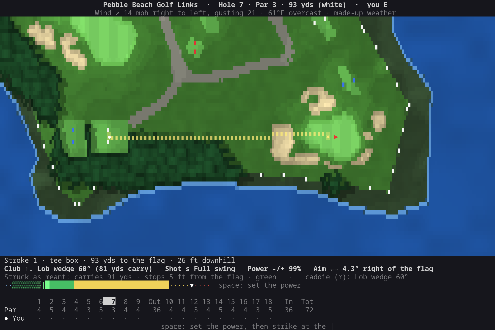
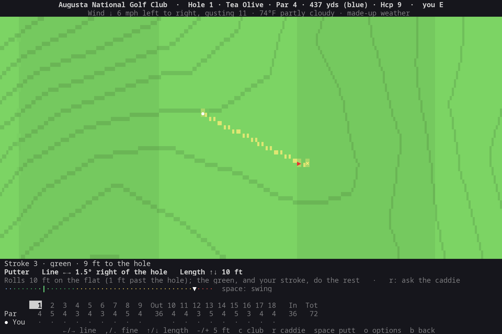
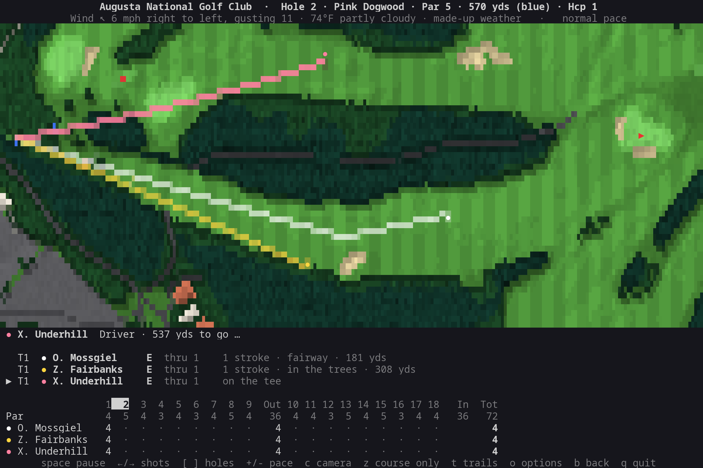
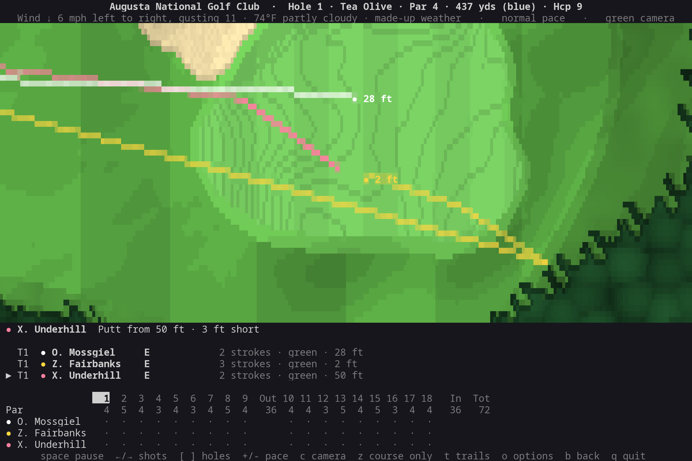
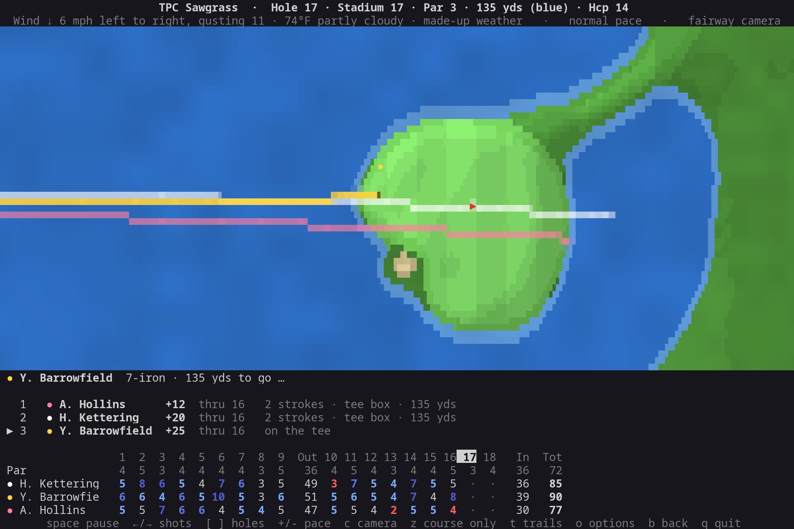
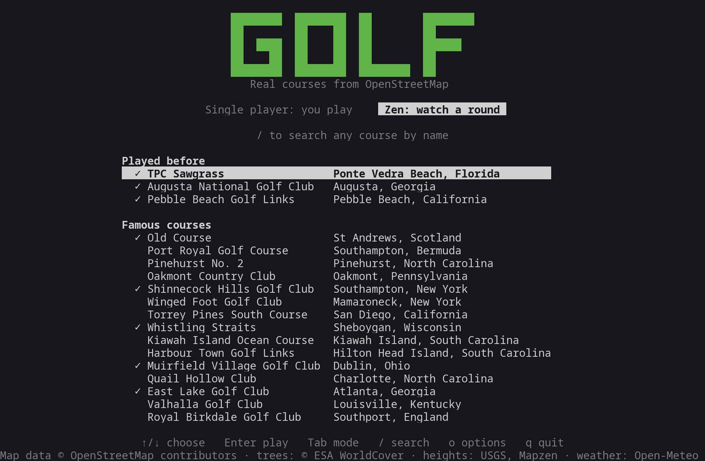

# golf

Golf in the terminal on real courses, drawn from OpenStreetMap. Two ways to play:

- **Single player**: you play the round. Aim, pick the club and the kind of shot, set how hard, and swing
  with the swing meter. A dotted line shows where it'll land; the caddie suggests a play for every shot.
- **Zen**: sit back and watch a group of made-up golfers play it, filmed like a TV broadcast from straight
  overhead.

Either way, the ball flies down the fairway (drawn above its shadow) on a camera that follows it, closes in
on the green for the putts, and a scorecard fills in underneath. Python 3.10 or newer, standard library only.

| Single player: the caddie's play on Pebble Beach's 7th | Close on the cup for a short putt |
|---|---|
|  |  |
| **Zen: three drives down Augusta's 2nd** | **The green camera for the putts** |
|  |  |
| **Weekend golfers meet Sawgrass's island 17th** | **The course list** |
|  |  |

The courses are real: every fairway, green, bunker, pond, creek and tree comes from OpenStreetMap. The
shots are worked out by a shot engine that every golfer's swing goes through, yours too (see
[The shot engine](#the-shot-engine)); the golfers in zen are made up.

## Running it

    golf-cli/bin/golf

There's nothing to install. To run it as `golf` from anywhere, link the launcher onto your `PATH`:

    ln -s "$PWD/golf-cli/bin/golf" ~/.local/bin/golf

Then:

    golf                    # the course list
    golf augusta            # straight to a course in the list (by part of its name)
    golf --play --you tour  # single player, as a tour player (saved)
    golf --zen --golfers 4 --level weekend --weather random   # zen: watch four weekend golfers (saved)
    golf pebble --seed 1234                                   # that round again
    golf --color 256 --symbols console                        # force a color mode or symbol set

## Keys

| Screen      | Keys |
|-------------|------|
| Course list | `↑/↓` choose · `Enter` play · `Tab` single player or zen · `/` search by name or place · `o` options · `q` quit |
| Single player | `←/→` aim · `,`/`.` aim finely · `↑/↓` club · `s` kind of shot · `-`/`+` power · `f` aim at the flag · `r` the caddie's play · `v` camera to aim on · `space` swing (and again for the meter) · `z` course only · `o` options · `b` back · `q` quit |
| Putting     | `←/→` line · `,`/`.` finely · `↑/↓` length by a foot · `-`/`+` by five · `c` change from the putter · `space` putt |
| Zen         | `space` pause · `→` on to what's next (the shot in the air lands) · `←` this shot again / the one before · `]`/`[` next hole / start of this hole · `+`/`-` pace · `c` camera · `z` course only · `g` close-up on the green · `t` trails · `o` options · `b` back · `q` quit |
| End of round | `Enter` a new round on the same course · `b` back to the list |
| Options     | `↑/↓` choose · `←/→` change · `o`/`Esc` close |

`Ctrl-L` repaints the screen if anything ever looks garbled.

## Setting up a round

After you pick a course, its round setup: single player or zen, all the holes or the front or back nine,
the tees (each set with its color and how long the course plays from it), the weather (the course's live
weather, a random day, calm, windy or wet), and your level and swing, or for zen the group and their level.
`Enter` tees off; the same screen comes up before each new round, as you left it.

A hole's tee boxes are back to front in the usual colors (black, blue, white, gold, red, and pink for a
sixth), unless the map tags them (`tee=blue`); each box has its two markers in its color on the map. A hole
with fewer boxes is played from the nearest set to the one chosen.

## Single player

How much the game helps is the **Help** setting (on the round's setup):

| Help | Each shot starts | The map shows | Caddie |
|------|------------------|---------------|--------|
| caddie | set up the caddie's way | where it lands and stops, in the wind, with the roll ("stops 9 ft from the flag · green") | its play shown |
| yardages | at the flag, with the club that carries the distance in still air (a putt: to finish a foot or two past) | where that swing comes down in still air: the wind, the bounce, the roll and the trouble are yours to judge | `r` asks |
| none | at the flag, with the club you hit last | just your line | none |

The shot line always says what the club carries ("7-iron (178 yds carry)"); the wind is at the top. On a long
hole `v` moves the camera from the whole hole to the target, or to just ahead of the ball; around the green
it's close up, and for a putt of 12 feet or less closer still, on the cup, where the line and the green's
contours (2 inches apart there) are big enough to read.

Then swing. With **the swing meter**, `space` starts the backswing, `space` again sets the power where the
meter has got to (▼ marks the power you set up; past 100% is an overswing: more distance, less control),
and `space` a third time, as the meter comes back down through the mark (`|`), strikes it. Early pulls and
hooks it; late pushes and slices it; let it run past and it's as late as it gets. The green round the mark is
the room you have, brightest where a strike is pure, and the shot says how you struck it. **Meter timing**
sets how much room that is: easy (0.4 s either side, and a slower meter), normal (0.2 s) or hard (under a
tenth). With **the simple swing**,
`space` hits it at the power set, with your level's usual scatter. Putts go on the meter too (unless the
caddie's helping): set the line and the length, and the meter says how far it rolls (100% is the length
set) and how straight.

What you can play depends on **your level**:

| Shot | What it does | Level |
|------|--------------|-------|
| Full swing | the club's full distance | everyone |
| Punch | low, three-quarters of the distance, runs out, cuts through the wind | everyone |
| Chip | low, runs most of the way (7-iron to lob wedge) | everyone |
| Pitch | flies most of the way, stops quicker (wedges) | everyone |
| Splash | out of a greenside bunker (sand or lob wedge) | everyone |
| Putt | on the green, or from just off it | everyone |
| Draw / Fade | curves left / right, runs more / less | scratch and tour |
| Flop | high and soft, stops dead, harder to strike | scratch and tour |
| Stinger | a low long-club shot that hardly feels the wind | tour |

Your level also sets how far and straight you hit it, how often a swing goes wrong, and your touch on and
around the greens: weekend, scratch or tour, as for the golfers in zen. The hole's summary has your score,
putts, whether you found the fairway and hit the green in regulation; the final card has the totals.

## Zen

Each hole opens on the whole hole, turned so it runs across the screen (tee on the left) or up it (tee at the
bottom), whichever shows it bigger: rough with a first cut round the fairways, striped fairways, greens with
their fringe, tee boxes, sand with its lip, water with its shallows, woods (pines darker) and single trees
lit from the upper left with their shadows, flowerbeds in bloom, gorse, hedges and cart paths. Round the
course is what's there: houses with their roofs and shadows, roads, parking, lawns and backyard pools, the
sea along a coast, and white stakes where out of bounds begins. In high detail each character is four
pixels, drawn with quadrant blocks.

Then the **broadcast camera** takes over, from straight overhead:

- **At address** it cuts to the golfer's ball, looking down the hole, with the yardage beside it.
- **In the air** it follows the ball with room ahead of it. The ball is drawn above its shadow, higher the
  higher it flies, and leaves a trail.
- **Where it stops** the camera settles, with the yardage that's left.
- **Around the green** chips and putts get the green camera, roomy enough for the whole putt, panning
  between the ball and the hole and labelling every ball with how far it is from the cup; a putt from 12
  feet or less, the camera on the cup.
- **The summary** goes back to the whole hole, with the scores on it.

`c` switches to the **whole-hole camera**: the hole always in view, with the close-up on the green for the
short game if you want it (`g`).

The shots take their real time: a drive hangs about five seconds and slows as it goes, a long putt takes a
few seconds to roll up. The **pace** (`+`/`-`: slow, normal, quick, rapid) only changes how long the round
lingers in between: on the tee, after each shot, and on each hole's intro and summary. At normal pace a
hole takes a minute or two.

Under the map is what the last shot did ("Driver · sliced · 268 yds · in the trees · 182 yds to go"), the
group in order of score with each ball's lie, and the scorecard: birdies in red, eagles in gold, bogeys in
blue. Nothing ahead of the shot being shown is given away. In a window 130 or more columns wide, the group
and the hole's shots go in a panel beside the map. Each of these can be turned off in the options, and the
map takes the room; **course only** (`z`) hides them all and gives the course the whole screen.

The group plays in golf's order: the best score on the last hole tees off first, and after that whoever is
farthest from the hole plays. `]` skips ahead a hole.

## The shot engine

Every swing, yours and the zen golfers', goes through the same engine. A golfer asks for a club, a line, a
kind of shot and how hard (and, with the swing meter, how well it was timed), and the engine works out the
rest from what's in play:

- **The lie.** What can be hit from it (a driver only off the tee, nothing longer than a 5-iron from the
  trees) and how well: the rough costs distance and control, the sand more, the trees most.
- **The club and the shot.** Its carry, roll and spread (wedges go by their loft: pitching wedge 46°, gap
  50°, sand 56°, lob 60°); the shot type's distance, height, curve, roll
  and how much the wind gets at it; how hard it's hit (a softer swing goes straighter, an overswing less so).
- **The golfer.** Their power and accuracy, their usual curve, how often a swing goes badly wrong, their
  touch around the green and on it; with the swing meter, your timing, which sends it the way you mistimed it.
- **The weather.** Into the wind costs carry and downwind adds some, a crosswind pushes the ball sideways
  (less for a low shot), heat makes it fly farther, and wet ground stops it rolling. Gusts vary shot to shot.
- **The ground.** The ball runs out on fairways, stops in the rough, plugs in bunkers, and kicks into
  hazards. Flowerbeds, gorse and hedges play like the trees.
- **The slopes** (where the course's heights are known; see Courses). A shot to lower ground carries about
  a yard farther for each yard it drops, and uphill comes up that much short. A rolling ball is slowed
  going uphill and sped up going down, and a slope across its line bends it, the more the slower it goes,
  so putts break and fall away at the end. A ball won't stop on a slope steeper than the grass can hold
  it: it trickles off down a bank. Greens are held to how greens are built (4% at most overall, 6% in any
  one spot), since the heights can be a few yards off them. Water costs a penalty stroke and a drop back on
  dry land; out of bounds (anything past the course's boundary, a house, the clubhouse) means stroke and
  distance.
- **The cup.** A ball drops only if it rolls over the cup slowly enough: a putt that would finish a few
  feet past, a chip running out, rarely a long iron. The zen golfers (and the caddie) read a putt or chip
  by trying it, until it rolls through the hole; then it scatters a little in line and pace, more the
  longer it is. From each distance they drop about as often as tour players' do: nearly all from 3 feet,
  4 in 10 from 10, 1 in 7 from 20. You read yours from the green's contour lines.

## How the zen golfers play

A golfer picks a club and a line the way a good player thinks. For each club they could hit, and each
place they could aim, they work out where the shot usually ends up and what that leaves. They take the
choice with the fewest strokes left on average, using the tour's strokes-to-hole-out from each distance
and lie (Mark Broadie's strokes-gained baselines). So they lay up short of water, play away from bunkers,
follow a dogleg's fairway and go for par 5s in two when the odds say so.

They allow for the wind they feel (clubbing up or down, aiming off), chip and pitch to finish just past the
hole, and putt to die a foot or so beyond it. Then the engine swings for them, with their usual scatter
and, now and then, a real miss: a slice or hook (worse for golfers who already curve it that way), a push,
pull, chunk, thin or shank; a skulled chip, a splash left in the sand. The same thinking is your caddie.

Each golfer has a made-up name and a game of their own: how far they hit it, how straight, how often a
swing goes wrong, their shot shape, their touch around the green and their putting. **Golfers' level** sets
the range:

| Level | Roughly shoots |
|-------|----------------|
| tour | around par (69-75 on Augusta, Pebble Beach or Sawgrass) |
| scratch | a few over (75-80) |
| weekend | 90-110, with plenty of slices into the trees |
| mixed | one of each |

A round comes from one seed, shown on the final scorecard: `golf <course> --seed N` with the same options
plays that round again, shot for shot (in single player, the same luck for the same swings).

## Courses

The list starts with famous courses that are mapped hole by hole (Augusta National, Pebble Beach, the Old
Course, TPC Sawgrass, Pinehurst No. 2, Oakmont, and more), then the ones you've played. `/` searches
OpenStreetMap for any course by name ("pebble", "kiawah"), or by place ("st andrews" lists every course
there). A course needs its holes mapped (`golf=hole`, a line from tee to green) to be playable; many are,
and the list marks the ones already downloaded with ✓.

A course downloads once, from the Overpass API, with what's mapped around it (two queries at once, a minute
or two between them), and is kept in `~/.cache/golf-cli/courses/`. It plays without its surroundings if
those can't be had, and they're tried again the next time. When one boundary holds more than one course (Augusta's par-3 course, Sawgrass's
Stadium and Dye's Valley), you choose which to play. Holes the mappers didn't say belong to which course
are grouped by walking from each green to the nearest next tee.

Mappers often leave out the trees between the holes, so they come from space: ESA WorldCover's satellite
land cover (every 10 m of the world classed as trees, grass, water...), read a block at a time from its
cloud-optimized files for the few kilometres round the course, and kept with it. Where the course's own
ground isn't mapped (its rough, and everything round it), those woods are drawn, and play as trees.
**Trees from satellite** in the options turns them off.

The heights come from lidar in the US: the USGS's 3D Elevation Program has the bare ground (trees and
houses taken out) to a metre or better, asked for in 2 m cells, which is enough to read a green by.
Elsewhere, or when the USGS's server is down, they come from Mapzen's terrain tiles (on Amazon's open data:
SRTM and the best national data, tens of metres), which show the hills but not the greens' contours. Either
way they're kept with the course (about 2 MB for a US course). A pin the map puts on a slope steeper than 3%
is moved to the flattest part of its green, the way greenkeepers cut the cup. On the map, **Slopes on the
map** shades the hills, banks and hollows in a few steps, lit from the top left, and draws contour lines on
the green close-up, 4 inches of height apart (the lines bunch up where it's steep); in single player, the
setup says how far the flag is above or below you (with yardages or the caddie).

What OpenStreetMap doesn't have is filled in: rough wherever nothing else is mapped, a par from the length,
the pin in the middle of the green, a round green where a hole ends without one, a size for each tree that
doesn't give its crown's (and some variety). Anything outside the course's boundary is out of bounds.

## Options

Saved to `~/.config/golf-cli/settings.json`; a file the app can't use is kept as `settings.json.bad`, with
a warning, rather than saved over.

- **Game**: single player or zen (`Tab` on the course list).
- **Your level** (weekend, scratch, tour), **Your swing** (the meter, or simple) and **Meter timing** (easy,
  normal, hard): single player.
- **Pace between shots**: slow, normal, quick or rapid. The shots themselves always take their real time.
- **Camera**: broadcast, or the whole hole.
- **Zen: golfers in the group** (1-4), **Zen: golfers' level**: for the next round.
- **Weather**: *live* is the course's weather right now (from Open-Meteo), *random* any day, *calm* no
  wind.
- **Distances**: yards and feet, or meters.
- **Holes**: all, front 9, back 9; and the tees, on the round's setup.
- **Trees from satellite**: the woods OpenStreetMap leaves out, from ESA WorldCover (on by default; from the
  next course loaded).
- **Slopes on the map**: on (the slopes shaded, and contour lines on the greens close up), greens only (just
  the contour lines), or off. The slopes play the same either way.
- **Map detail**: high (quadrant blocks, four pixels to a character), standard (half blocks, two), or auto:
  high unless the symbols are console-safe or ASCII, whose fonts lack the quadrants.
- **Close-up on the green**, **Shot trails**.
- **Hole layout**: across, up, or auto (whichever shows the hole bigger).
- **How much of the screen the panels take**: **Course only** (`z`: nothing but the course), or one by one **Title and weather**, **What each
  shot did**, **The group's standing**, **Scorecard** (all 18 when they fit, just the nine being played, or
  off), **Side panel** in wide windows, and **Key help**.
- **Color mode** and **Symbols**, as in scoreboard: 16-color terminals get a palette whose greens still
  tell apart, and the Linux console and ASCII terminals get one-column stand-ins for every symbol.

## Data and credits

- Courses: **© OpenStreetMap contributors**, under the Open Database License (ODbL), through the
  [Overpass API](https://overpass-api.de/) (with a second server if the first doesn't answer). Search by
  name: [Nominatim](https://nominatim.openstreetmap.org/), at most one request a second as its policy asks.
- Trees: © ESA WorldCover project 2021 / Contains modified Copernicus Sentinel data (2021) processed by
  ESA WorldCover consortium, under CC BY 4.0 ([esa-worldcover.org](https://esa-worldcover.org/)).
- Heights: in the US, the [USGS 3D Elevation Program](https://www.usgs.gov/3d-elevation-program) (public
  domain); elsewhere, Mapzen's [terrain tiles](https://registry.opendata.aws/terrain-tiles/), from SRTM,
  GMTED2010, NED, ETOPO1 and others ([attribution](https://github.com/tilezen/joerd/blob/master/docs/attribution.md)).
- Live weather: [Open-Meteo](https://open-meteo.com/), free for non-commercial use, no key.
- The zen golfers, and everyone's shots and scores, are made up.

## Development

    bin/golf                launcher (works through a symlink)
    golf/
      app.py                argument parsing, screen loop
      screens.py            course list, loading, zen's round view: its playback, the camera director,
                            the maps made ahead on a worker thread
      play.py               single player's round view: aiming, the swing meter, the flight
      game.py               a round you play: the caddie, your setup, your scorecard and stats
      course.py             Course and Hole, and what the ground is anywhere on a course
      osm.py                courses from OpenStreetMap (Overpass): download, cache, parse; tees
      landcover.py          the trees from satellite land cover (ESA WorldCover's GeoTIFFs, by range request)
      elevation.py          the heights: USGS lidar or terrain tiles, the ground in course yards, steep greens eased
      catalog.py            famous courses, played ones, search (Nominatim, Overpass)
      geo.py                flat geometry in yards: projection, polygons, paths, frames
      clubs.py              the bag: carries, roll, spread; lies; club choice
      players.py            the made-up golfers and their levels
      weather.py            live, random or calm weather, and what it does to a shot
      engine.py             the shot engine: swings, shot types, flight, wind, slopes, roll, the cup, penalties,
                            reading a putt
      sim.py                the zen golfers' strategy, and their rounds
      scoring.py            score names, to-par, standings, scorecard colors
      render.py             the hole map: terrain, shading, quadrant or half blocks, the camera's view,
                            balls, trails and the flag
      panels.py             shot descriptions, the group, the scorecard, the wind
      term.py net.py        terminal I/O and colors; HTTP (from scoreboard-cli)
      settings.py files.py  settings file and options menu; where things are kept on disk
    tests/                  unittest suite on a small made-up course; no network
    tools/
      screenshots.py        the README's screenshots, made again from the app's own screens
      ansi2png.py           a frame of the app as a PNG, as a terminal shows it

Run the tests with `python3 -m unittest discover -s tests -t .` from the top of the repo.

The screenshots in `images/` come from `python3 tools/screenshots.py` (or `... putting` for one of
them), which plays fixed-seed scenes on the cached courses and draws them on a 120 by 40 terminal. It
needs [Pillow](https://pypi.org/project/pillow/); the app itself doesn't.
