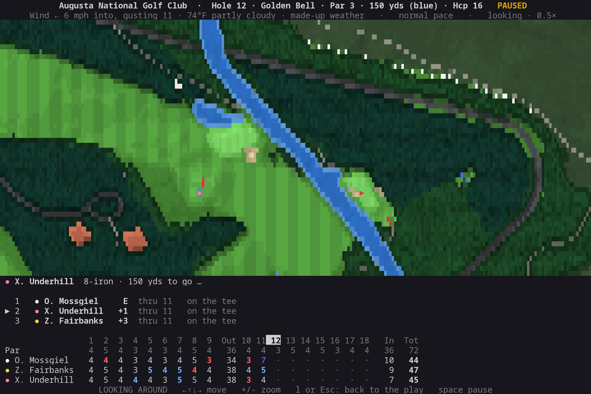
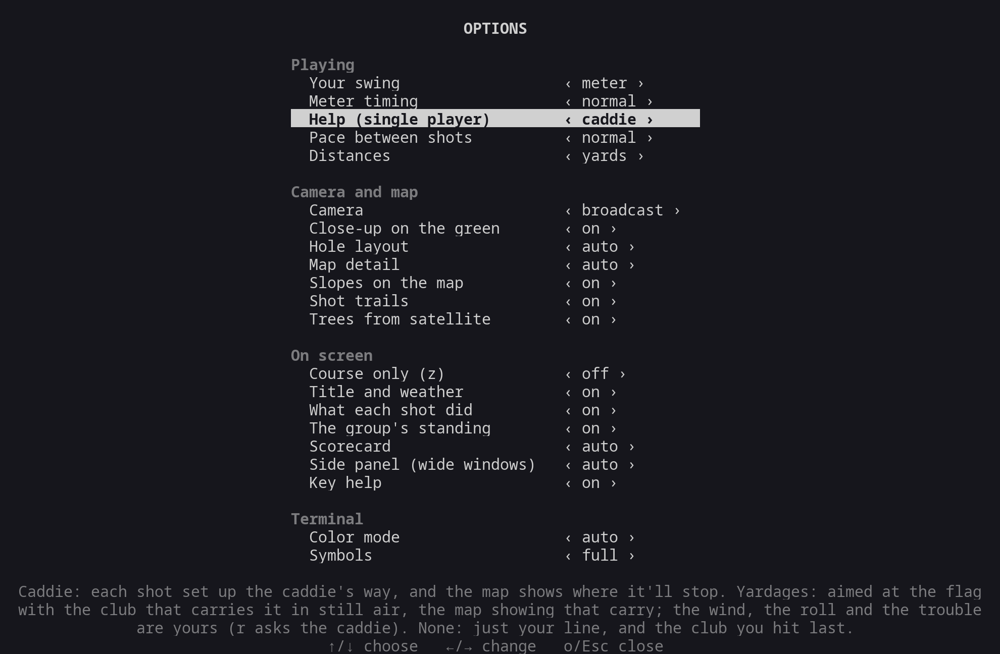

# golf

Golf in the terminal, on real courses drawn from OpenStreetMap. Every fairway, green, bunker, pond, creek
and tree is where it really is. You can play two ways:

- **Single player**: play the round yourself. Aim, pick the club and the kind of shot, and swing with the
  swing meter. A dotted line shows where it'll go, and a caddie can suggest the play.
- **Zen**: sit back and watch a group of made-up golfers play it, filmed like a TV broadcast from straight
  overhead.

Either way, the ball flies down the fairway on a camera that follows it and closes in on the green for the
putts. The ball curves as it should, and a putt curls along the slopes. A scorecard fills in underneath.

It needs Python 3.10 or newer and nothing else.

| Single player: the caddie's play on Pebble Beach's 7th | A 9-foot putt, close on the cup |
|---|---|
|  |  |
| **Zen: three drives down Augusta's 2nd** | **The green camera for the putts** |
|  |  |
| **Weekend golfers meet Sawgrass's island 17th** | **Looking around: Amen Corner, zoomed out** |
|  |  |
| **The course list** | **The options** |
|  |  |

## Contents

- [Quick start](#quick-start)
- [Single player](#single-player)
- [Zen](#zen)
- [Looking around](#looking-around)
- [Keys](#keys)
- [Setting up a round](#setting-up-a-round)
- [Options](#options)
- [Courses](#courses)
- [Data and credits](#data-and-credits)
- [Development](#development)
- [How it works](HOW-IT-WORKS.md): the shot engine, the zen golfers, the camera, the course data

## Quick start

    golf-cli/bin/golf

There's nothing to install. To run it as `golf` from anywhere, link the launcher onto your `PATH`:

    ln -s "$PWD/golf-cli/bin/golf" ~/.local/bin/golf

Then:

    golf                    # the course list
    golf augusta            # straight to a course in the list (by part of its name)
    golf --play --you tour  # single player, as a tour player
    golf --zen --golfers 4 --level weekend --weather random   # zen: watch four weekend golfers
    golf pebble --seed 1234                                   # that round again, shot for shot
    golf --color 256 --symbols console                        # force a color mode or symbol set

The options you give are saved for next time (except `--seed`, `--color` and `--symbols`). Press `?` in a
round to see every key.

## Single player

Each shot goes like this:

1. **Aim** with `←`/`→` (`,`/`.` for small steps). `f` points you back at the flag.
2. **Pick the club** with `↑`/`↓`, and **the kind of shot** with `s`: full swing, punch, chip and so on.
3. **Set how hard** with `-`/`+`. On the meter, this only marks the power you're aiming for (▼).
4. **Swing** with `space`. With the swing meter it takes three presses:
   1. The first starts the backswing.
   2. The second sets the power where the meter has got to. Past 100% is an overswing: more distance, less
      control.
   3. The third strikes it, as the meter comes back down through the mark (`|`). The green round the mark
      is the room you have, brightest where a strike is pure. Early pulls and hooks it; late pushes and
      slices it.

   `Esc` on the meter calls the swing off. Holding space down never swings: the first press after a shot
   has to come after a short pause.

**Putting** works the same way. `←`/`→` set the line, and `↑`/`↓` set the length a foot at a time
(`-`/`+` by five feet). On the meter, 100% rolls the length you set. With the caddie's help, putts skip
the meter: the caddie reads them and you putt with your level's usual stroke.

How much the game helps is the **Help** setting:

| Help | Each shot starts | The map shows | On the green |
|------|------------------|---------------|--------------|
| caddie | set up the caddie's way | the whole shot as struck just right, in the wind: its flight curving, its roll, where it stops | the putt's line, curling with the break |
| yardages | at the flag, with the club that carries the distance in still air | where that swing comes down in still air (its curve included): the wind, the bounce and the roll are yours to judge (`r` asks the caddie) | a read: "2 in uphill · breaks right to left, 1.5%" |
| none | at the flag, with the club you hit last | just your line | just your line |

You can change the help in the options during a round. The shot in front of you is set up again with it.

The shot line under the map says what the club carries ("7-iron (178 yds carry)"); the wind is at the top.
`v` moves the camera from the whole hole to the target, or to just ahead of the ball. Around the green the
camera closes in, and for a putt of 12 feet or less it goes closer still, onto the cup. There the line and
the green's contours (2 inches of height apart) are big enough to read.

**Meter timing** sets how much room you get at the strike: easy (0.4 s either side, and a slower meter),
normal (0.2 s) or hard (under a tenth). With **the simple swing**, `space` hits it at the power set,
with your level's usual scatter.

What you can play depends on **your level**:

| Shot | What it does | Who can play it |
|------|--------------|-----------------|
| Full swing | the club's full distance | everyone |
| Punch | low, three-quarters of the distance, runs out, cuts through the wind | everyone |
| Chip | low, runs most of the way (7-iron to lob wedge) | everyone |
| Pitch | flies most of the way, stops quicker (wedges) | everyone |
| Splash | out of a greenside bunker (sand or lob wedge) | everyone |
| Putt | on the green, or from just off it | everyone |
| Draw / Fade | curves left / right, runs more / less | scratch and tour |
| Flop | high and soft, stops dead, harder to strike | scratch and tour |
| Stinger | a low long-club shot that hardly feels the wind | tour |

Your level (weekend, scratch or tour) also sets how far and straight you hit it, how often a swing goes
wrong, and your touch around the greens. Each hole's summary has your score, your putts, whether you found
the fairway and whether you hit the green in regulation. The final card has the totals.

## Zen

Each hole opens on the whole hole. Then the **broadcast camera** takes over:

- **At address** it cuts to the golfer's ball, looking down the hole, with the yardage beside it.
- **In the air** it follows the ball. The ball is drawn above its shadow, higher the higher it flies, and
  leaves a trail.
- **Where it stops** the camera settles, with the yardage that's left.
- **Around the green** it closes in, labelling every ball with how far it is from the cup. For a putt
  from 12 feet or less it goes onto the cup.
- **The summary** goes back to the whole hole, with the scores on it.

`c` switches to the **whole-hole camera**, which keeps the hole in view (with the green close-up for the
short game if you want it, `g`).

The shots take their real time: a drive hangs about five seconds. The **pace** (`+`/`-`: slow, normal,
quick, rapid) only changes how long the round lingers between shots. At normal pace a hole takes a minute
or two.

Under the map are what the last shot did ("Driver · sliced · 268 yds · in the trees · 182 yds to go"), the
group in order of score, and the scorecard: birdies in red, eagles in gold, bogeys in blue. Nothing ahead of
the shot being shown is given away. In a window 130 or more columns wide, the group and the hole's shots go
beside the map. `z` (**course only**) hides all of it and gives the course the whole screen.

The group plays in golf's order: the best score on the last hole tees off first, and after that whoever is
farthest from the hole plays. The golfers each have a game of their own: tour players shoot around par,
scratch players a few over, and weekend golfers around 90 (anywhere from 80 to 110). See
[how the zen golfers play](HOW-IT-WORKS.md#how-the-zen-golfers-play).

## Looking around

Press `l` in either mode to take the camera yourself:

- `←` `↑` `↓` `→` move it, a sixth of the screen at a time.
- `+` and `-` zoom in and out: from twice the whole hole (to see the holes round it) down to the cup.
- `l` or `Esc` hands the camera back (in single player, `space` does too, without swinging).

Zen keeps playing while you look (`space` pauses it). A new map takes a moment to draw the first time
(the header says "drawing…"). Wherever the camera is, an arrow at the screen's edge points to a ball that's
out of view.

## Keys

| Where | Keys |
|-------|------|
| Course list | `↑`/`↓` choose · `Enter` play · `Tab` single player or zen · `/` search by name or place · `o` options · `q` quit |
| Round setup | `↑`/`↓` choose · `←`/`→` change · `Enter` tee off · `b` back |
| Single player | `←`/`→` aim · `,`/`.` aim finely · `↑`/`↓` club · `s`/`S` kind of shot · `-`/`+` power · `f` aim at the flag · `r` the caddie's play · `v` camera to aim on · `space` swing (`Esc` calls it off) · `l` look around · `z` course only · `?` keys · `o` options · `b` back · `q` quit (`b` and `q` twice, once the round's started) |
| Putting | `←`/`→` line · `,`/`.` finely · `↑`/`↓` length by a foot · `-`/`+` by five · `c` change from the putter · `space` putt |
| Zen | `space` pause · `→` on to what's next · `←` this shot again / the one before · `]`/`[` next hole / start of this hole · `+`/`-` pace · `c` camera · `g` green close-up · `t` trails · `l` look around · `z` course only · `?` keys · `o` options · `b` back · `q` quit |
| Looking around | `←↑↓→` move · `+`/`-` zoom · `l` or `Esc` back |
| End of round | `Enter` a new round on the same course · `b` back to the list |
| Options | `↑`/`↓` choose · `←`/`→` change · `o`/`Esc` close |

`Ctrl-L` redraws the screen if anything ever looks garbled.

## Setting up a round

After you pick a course you get its round setup. Each line shows what it does when you select it:

- **Game**: single player or zen.
- **Holes**: all of them, or the front or back nine.
- **Tees**: each set with its color and how long the course plays from it.
- **Weather**: the course's live weather, a random day, calm, windy or wet.
- **Single player**: your level, your swing (meter or simple), the meter timing and the help.
- **Zen**: how many golfers in the group (1–4) and their level (tour, scratch, weekend, or mixed).
- **Pace** between shots.

`Enter` tees off. The same screen comes up before each new round, as you left it.

## Options

`o` opens the options from anywhere. They're saved to `~/.config/golf-cli/settings.json`. The round's own
settings (above) are on its setup screen instead, since they can't change once it's started.

| Section | Options |
|---------|---------|
| Playing | **Your swing** (meter or simple) · **Meter timing** (easy, normal, hard) · **Help** (caddie, yardages, none) · **Pace between shots** · **Distances** (yards and feet, or meters) |
| Camera and map | **Camera** (broadcast or the whole hole) · **Close-up on the green** · **Hole layout** (across, up, or whichever shows it bigger) · **Map detail** (high: quadrant blocks, four pixels to a character; standard: half blocks; auto) · **Slopes on the map** (shaded hills and green contours; just the contours; off) · **Shot trails** · **Trees from satellite** |
| On screen | **Course only** · **Title and weather** · **What each shot did** · **The group's standing** · **Scorecard** (all 18, the nine being played, or off) · **Side panel** in wide windows · **Key help** |
| Terminal | **Color mode** (truecolor, 256, 16) · **Symbols** (full Unicode, console-safe, ASCII) |

16-color terminals get a palette whose greens still tell apart, and the Linux console and ASCII terminals get
one-column stand-ins for every symbol. If the settings file can't be used, it's kept as `settings.json.bad`
(with a warning) rather than saved over.

## Courses

The list starts with famous courses that are mapped hole by hole: Augusta National, Pebble Beach, the Old
Course, TPC Sawgrass, Pinehurst No. 2, Oakmont and more. After them come the ones you've played. `/`
searches OpenStreetMap for any course by name ("pebble", "kiawah") or by place ("st andrews" lists every
course there). A ✓ marks the courses already downloaded.

A course downloads once (a minute or two the first time) and is kept in `~/.cache/golf-cli/courses/`. The
heights come from USGS lidar in the US, accurate enough to read a green by, and from coarser terrain tiles
elsewhere. Trees the mappers left out come from satellite land cover. When one boundary holds more than one
course (Augusta's par-3 course, Sawgrass's Stadium and Dye's Valley), you choose which to play.
[More on the course data](HOW-IT-WORKS.md#the-courses).

## Data and credits

- Courses: **© OpenStreetMap contributors**, under the Open Database License (ODbL), through the
  [Overpass API](https://overpass-api.de/) (with a second server if the first doesn't answer). Search by
  name: [Nominatim](https://nominatim.openstreetmap.org/), at most one request a second as its policy asks.
- Trees: © ESA WorldCover project 2021 / Contains modified Copernicus Sentinel data (2021) processed by
  ESA WorldCover consortium, under CC BY 4.0 ([esa-worldcover.org](https://esa-worldcover.org/)).
- Heights: in the US, the [USGS 3D Elevation Program](https://www.usgs.gov/3d-elevation-program) (public
  domain); elsewhere, Mapzen's [terrain tiles](https://registry.opendata.aws/terrain-tiles/), from SRTM,
  GMTED2010, NED, ETOPO1 and others ([attribution](https://github.com/tilezen/joerd/blob/master/docs/attribution.md)).
- Live weather: [Open-Meteo](https://open-meteo.com/), free for non-commercial use, no key.
- The zen golfers, and everyone's shots and scores, are made up.

## Development

Run the tests from the top of the repo (they never touch the network):

    python3 -m unittest discover -s tests -t .

The screenshots in `images/` come from `python3 tools/screenshots.py` (or `... putting` for just one of
them). It plays fixed-seed scenes on the cached courses and draws them on a 120 by 40 terminal. It needs
[Pillow](https://pypi.org/project/pillow/); the app itself doesn't.

[How it works](HOW-IT-WORKS.md) explains the engine, the camera and the course data, and lists what
each file in `golf/` does.
